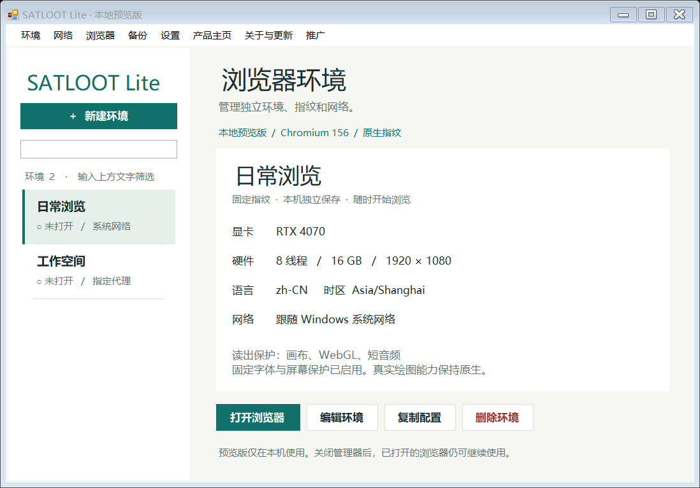

# SATLOOT Lite

## 能用来注册 Claude 吗？

**可以使用 SATLOOT Lite 打开 Claude 官网，并手动进行账号注册和登录。** 前提是你的网络、所在地区和账号符合服务方的使用条件。本软件不提供 Claude 账号或注册代办服务。

作者反馈：在自己的测试条件下，注册过程中通常未出现 KYC 身份验证。**这是个人实测经验，没有可核验的统计样本，不能作为通过率或“大概率免 KYC”的保证。**

注册能否成功、是否出现手机号验证、KYC 或其他检查，以及后续账号状态，均由 Claude / Anthropic 决定，并可能随网络、地区、账号和平台策略变化。本软件不会关闭或绕过网站的验证，不保证免 KYC、免风控、免封号或完全防关联。SATLOOT 与 Anthropic 无官方关联。

**独立环境浏览器 · Windows x64 · 本地保存**

一个简洁的桌面浏览器环境管理器。为日常浏览、工作和不同网站身份建立各自的环境，分别保存 Cookie、网站登录、指纹设置与网络配置。

[下载 Windows 完整版](https://browser.satloot.com/downloads/SATLOOT-Lite-0.3.1-windows-x64.zip) · [产品主页](https://browser.satloot.com/) · [问题反馈](https://github.com/q3579338/satloot-browser-lite/issues) · [联系作者](mailto:admin@satloot.com)



## 开源范围

本仓库公开 **Lite 管理器的 C# / Windows Forms 源码**，使用 MIT 许可，可以自行审查、修改和编译。

**SATLOOT Chromium 内核以编译好的二进制提供下载，本仓库不公开其修改源码，也不是完整 Chromium 源码仓库。** 内核、字体和网络组件继续适用各自附带的许可，详情见 [第三方声明](THIRD_PARTY.md)。

没有 AI 控制、钱包、云同步或自动化注册功能。当前提供 Windows 10 / 11 x64 版本；管理器使用 Windows Forms 和 Windows DPAPI，不能直接在 macOS / Linux 上构建运行。

## 下载与开始使用

当前完整包：**0.3.1 预览版**，约 **532 MB**，解压后约 **1.44 GB**。建议预留至少 4 GB 空间及后续环境数据空间。

1. [下载 Windows ZIP](https://browser.satloot.com/downloads/SATLOOT-Lite-0.3.1-windows-x64.zip)，完整解压。
2. 运行 `SATLOOT Lite.exe`，保留旁边的整个 `vendor` 目录。
3. 点击「新建环境」，设置名称、语言、时区和网络，保存后打开浏览器。
4. 每个环境独立保存网站数据。复制配置会生成新指纹，不复制原环境的登录状态。

发行包 SHA-256：

```text
933a3f6459d1cacd22357f897816e9dcf65be842d335200f84b5f6d480d81305
```

可以在 PowerShell 使用 `Get-FileHash -Algorithm SHA256 <下载的ZIP路径>` 核对。机器可读的版本、大小和校验信息见 [runtime-release.json](runtime-release.json)。哈希用于完整性核对，不是代码签名。

## 功能

| 功能 | 说明 |
| --- | --- |
| 独立环境 | 新建、编辑、重命名、复制配置、批量打开与关闭，网站数据分别保存 |
| 固定指纹 | 硬件组合、语言、时区、屏幕、字体，以及画布、WebGL、短离线音频读出设置 |
| 环境网络 | 系统网络、直接连接、指定 HTTP / SOCKS5 代理，线路库支持带认证的代理 |
| 导入线路 | 粘贴、UTF-8 文件、Base64 和 HTTPS 订阅预览导入；支持 HTTP、HTTPS、SOCKS5、VLESS、VMess、Trojan、Shadowsocks |
| 常用入口 | 扩展、书签、历史、下载、浏览器设置与返回已打开的浏览器窗口 |
| 本机备份 | 加密备份与恢复为新环境，最多 256 MB；仅同一 Windows 账户可解密 |
| 多语言 | 简体中文、繁體中文、English |
| 永久删除 | 需先关闭环境；删除不经过回收站，不可撤销 |

节点通过独立的 sing-box 进程运行，不修改系统代理。节点服务器域名可能通过系统 DNS 解析；时区和语言需自行核对。本版不支持 Clash YAML / JSON 导入、自动时区匹配或订阅自动刷新。

## 从源码编译 Windows 管理器

需要 Windows x64、PowerShell 和系统提供的 .NET Framework 4.x 编译器。项目不依赖 Node.js、Python、Visual Studio 项目文件或 NuGet 包还原。

```powershell
git clone https://github.com/q3579338/satloot-browser-lite.git
cd satloot-browser-lite
powershell -NoProfile -ExecutionPolicy Bypass -File .\scripts\build.ps1
```

输出：

- `preview/SATLOOT Lite.exe`：正式管理器，不包含测试入口。
- `evidence/SATLOOT Lite QA.exe`：独立测试程序，不要分发给普通用户。

源码编译只生成管理器，**不会编译或自动下载内核**。要运行自编译版本，请下载上面的完整包并核对哈希，将其中的整个 `vendor` 目录及第三方许可文件复制到 `preview/`。程序会核对指定内核的清单与各文件哈希；不能随意换成普通 Chrome 或其他版本的内核。

```text
preview/
  SATLOOT Lite.exe
  THIRD-PARTY.txt
  vendor/
    satloot-chromium/
      chrome.exe
      runtime-manifest.json
      ...完整内核资源与许可...
    sing-box/
      sing-box.exe
      libcronet.dll
      ...许可文件...
```

可指定输出目录，避免覆盖正在运行的管理器：

```powershell
powershell -NoProfile -ExecutionPolicy Bypass -File .\scripts\build.ps1 -OutputDirectory .\build\manager -QaOutputDirectory .\build\qa
```

## 验证与限制

下载并解压完整包后，可运行管理器检查。`RuntimePackage` 指向包含 `vendor` 的文件夹，例如：

```powershell
powershell -NoProfile -ExecutionPolicy Bypass -File .\scripts\test.ps1 -RuntimePackage 'C:\Downloads\SATLOOT Lite'
```

测试使用新的独立身份和合成数据，不读取真实环境，不显示浏览器窗口。检查涵盖配置持久化、启动参数、内核文件校验、网络配置、备份恢复、删除保护、语言切换及状态刷新。结果保存在本地 `build/tests/`，不会上传。

此次发布前的源码审查及验证范围见 [审查记录](docs/REVIEW-2026-10-27.md)。测试通过不代表所有网站兼容，也不代表已完成独立第三方安全审计。OVH 个别页面的交互卡顿仍在跟踪，不承诺所有网站都流畅。

网站数据保存在 `%LOCALAPPDATA%\SATLOOT Browser Lite Preview\`。关闭管理器不会关闭已经打开的浏览器。当前没有自动更新，升级前请正常关闭程序，并保留自己的环境数据。

## 交流与贡献

作者：**SATLOOT** · 邮箱：[admin@satloot.com](mailto:admin@satloot.com)

欢迎提交 [Issue](https://github.com/q3579338/satloot-browser-lite/issues) 和管理器改进，详见 [贡献指南](CONTRIBUTING.md)。安全问题请按 [安全反馈说明](SECURITY.md) 私下联系；请不要公开账号、Cookie、订阅地址或节点凭据。

### English

SATLOOT Lite is a Windows x64 desktop manager for separate local browser profiles, fingerprint settings and per-profile proxy routes. The **manager source is MIT-licensed**; the SATLOOT Chromium runtime is **distributed separately as a binary**, and its modifications are not published in this repository. It contains no AI control or automated account registration.

The prebuilt Windows package is available from the download link above. Users can manually access and register for Claude where eligible. The author's experience of registrations without KYC is anecdotal, not a measured success rate or a promise to bypass verification. SATLOOT is not affiliated with Anthropic.
